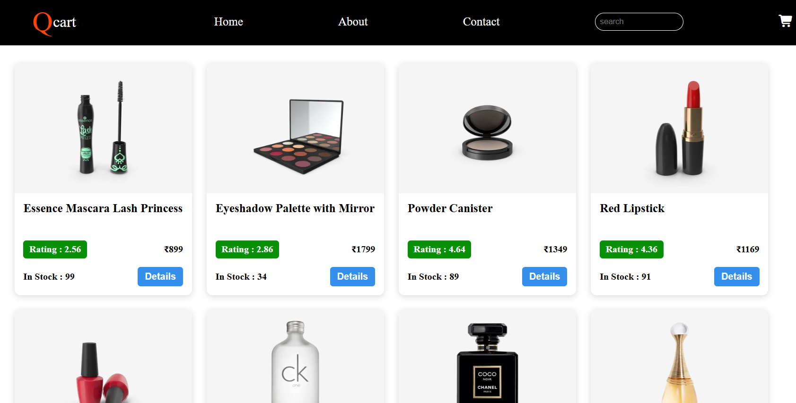
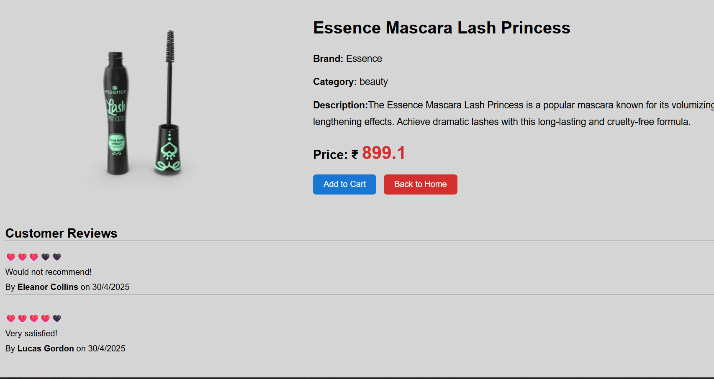
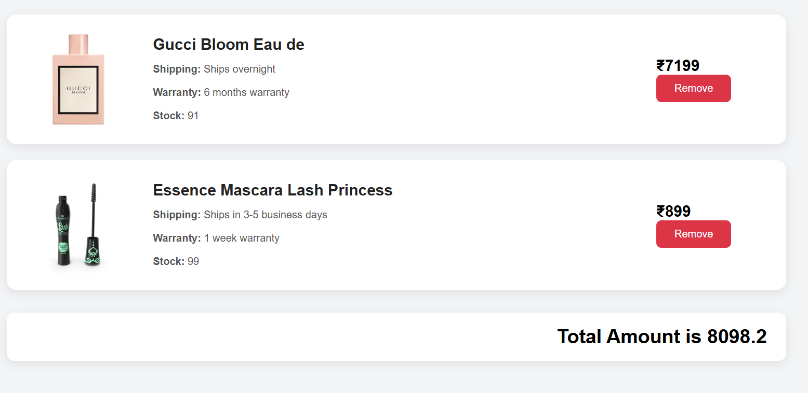

# 🛍️ QCart — E-commerce Web Application

QCart is a responsive e-commerce frontend built using **HTML, CSS, and JavaScript**. It allows users to browse products, search for items, view product details, manage a shopping cart, and explore basic registration and login functionality.

## 📸 Screenshots

### 1. Login Page


### 2. Home Page — Product Listing


### 3. Product Details Page


### 4. Shopping Cart


## ✨ Features

- **Dynamic Product Listing:** Fetches product information from the DummyJSON REST API.
- **Product Search:** Search and discover products through the home page.
- **Product Details:** Displays product images, descriptions, prices, brands, categories, stock availability, and customer reviews.
- **Shopping Cart:** Add products, remove items, and calculate the total amount.
- **Registration and Login:** Provides basic client-side registration and login validation.
- **Local Storage:** Persists cart items and selected application data across page navigation and browser sessions.
- **Responsive Interface:** Provides a clean shopping experience using HTML and CSS.

## 🛠️ Tech Stack

| Technology | Purpose |
|---|---|
| HTML5 | Page structure |
| CSS3 | Styling and responsive layouts |
| JavaScript | Application logic and DOM manipulation |
| Fetch API | Retrieving product data |
| DummyJSON API | Product data source |
| Local Storage | Browser-side data persistence |
| Font Awesome | Icons |

## 🌐 API Integration

QCart uses the DummyJSON Products API to retrieve product information.

**API endpoint:**

`https://dummyjson.com/products`

JavaScript's Fetch API is used to request data, process JSON responses, and dynamically display products on the page.

## 📂 Project Structure

```text
E-commerce/
├── Home/
│   ├── home.html
│   ├── home.css
│   └── home.js
├── Details/
│   ├── details.html
│   ├── details.css
│   └── details.js
├── Cart/
│   ├── cart.html
│   ├── cart.css
│   └── cart.js
├── Registration/
│   ├── register.html
│   ├── register.css
│   ├── register.js
│   ├── login.html
│   ├── login.css
│   └── login.js
└── README.md
```

## 🚀 Getting Started

### Prerequisites

- A modern web browser
- Visual Studio Code
- Live Server extension
- Internet connection for API requests

### Installation

1. Clone the repository:

   ```bash
   git clone https://github.com/skbakshu/QCart.git
   ```

2. Open the project folder in Visual Studio Code.

3. Install the **Live Server** extension if necessary.

4. Open `Home/home.html`.

5. Right-click the file and select **Open with Live Server**.

6. Browse products, view product details, add items to the cart, and explore the login and registration pages.

> Replace the repository URL above with your actual GitHub repository URL if the project uses a different repository name.

## 🧠 Key Learning Outcomes

- Integrating REST APIs into a frontend application.
- Using asynchronous JavaScript and Fetch API.
- Processing JSON responses and dynamically rendering data.
- Managing cart state and persisting data with Local Storage.
- Implementing search, product details, and cart operations.
- Building and connecting multiple HTML pages using JavaScript.

## 🔒 Security Considerations

This project is a frontend demonstration and does not implement production-grade authentication. Client-side credential validation and storing passwords in Local Storage are not secure for real-world applications.

A production version should use a backend API, secure password hashing, server-side validation, and appropriate session or token management.

## 🔮 Future Enhancements

- Develop a backend with a database for persistent user accounts and orders.
- Implement secure authentication and authorization.
- Add product quantity controls and improved cart calculations.
- Add checkout, payment integration, and order history.
- Improve API error handling and loading states.
- Deploy the application for public access.

## 👨‍💻 Author

**Shaik Allah Bakshu**

- GitHub: [skbakshu](https://github.com/skbakshu)
- LinkedIn: [shaikbakshu](https://linkedin.com/in/shaikbakshu)

---

⭐ If you find this project useful, consider giving the repository a star.

*QCart — Exploring frontend development, REST API integration, and browser-based state management.*